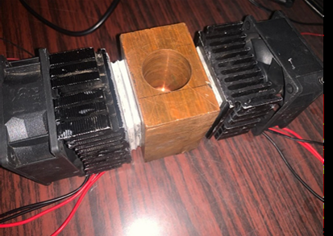
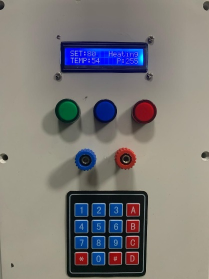
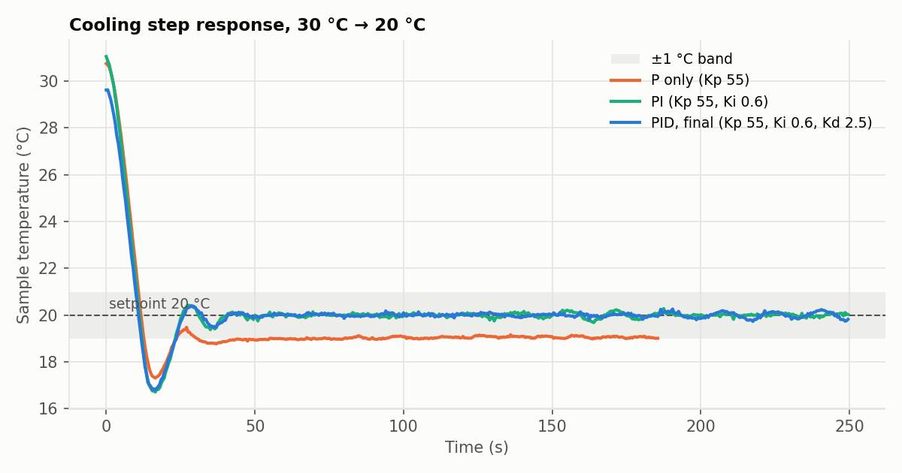
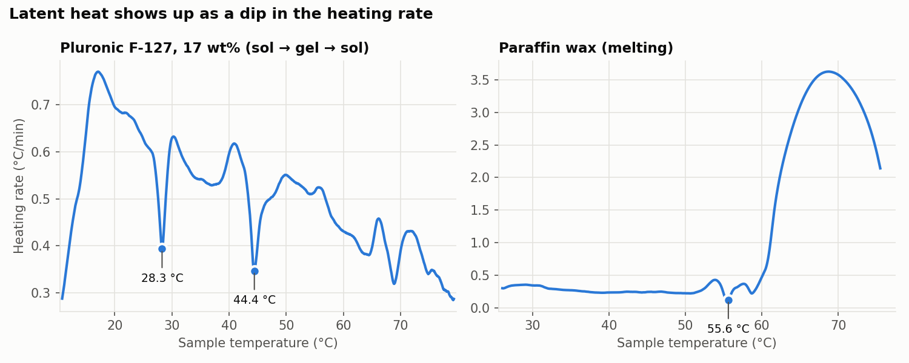
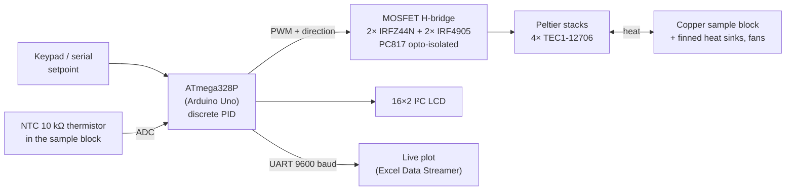
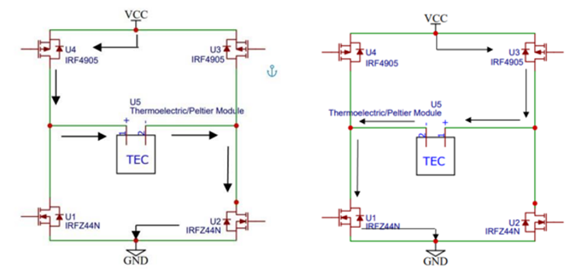

# Peltier-Based Temperature Regulator for Phase-Transition Studies

A PID-controlled thermoelectric stage that heats **and** cools a ~10 cm³ sample between about 9 °C and 80 °C, logs its temperature, and finds phase transitions from the dip that latent heat leaves in the heating rate. It is a low-cost alternative to a water bath and thermometer, and to Differential Scanning Calorimetry (DSC), for small labs characterising materials such as thermosensitive hydrogels.

Final-year research project, Department of Physics and Electronics, University of Kelaniya (July 2023 – July 2024).

<p align="center">
  
  &nbsp;
  
</p>

## Results

All numbers below are recomputed from the raw logs in [`data/`](data) by [`analysis/plot_results.py`](analysis/plot_results.py).

| Measurement | Result |
|---|---|
| Step response, 30 °C → 20 °C (cooling) | inside ±1 °C after **24 s** |
| Steady state at 20 °C (last 120 s) | mean 20.00 °C, SD **0.10 °C**, max deviation 0.27 °C |
| Pluronic F-127, 17 wt%: sol → gel | **28.3 °C** (literature: 28–29 °C) |
| Pluronic F-127, 17 wt%: gel → sol | **44.4 °C** (literature: 44–45 °C) |
| Paraffin wax: melting | **55.6 °C** |



Gains were tuned by trial and error, one at a time, at a 20 °C setpoint. P-only control settles about 1 °C low; adding the integral term removes the offset, and the derivative term trims the undershoot. All 17 tuning runs are in [`data/pid_tuning/`](data/pid_tuning).



While a sample changes phase, the heat it receives goes into restructuring rather than warming it, so its heating rate drops. The script smooths the log, differentiates it and reports the deepest local minima.

## How it works



- **Thermal stage:** a machined copper block with a bored hole for a test tube sits between two stacks of TEC1-12706 modules (two per side). Finned heat sinks and fans reject heat from the hot faces; 2 mm glass-wool insulation surrounds the sample.
- **Power stage:** an H-bridge reverses the current through the modules, so the same face heats or cools. PWM on one leg sets the drive level.

  

- **Sensing:** a 10 kΩ NTC thermistor (B = 3950 K) in a voltage divider, converted with the Steinhart–Hart equation and averaged over 10 readings.
- **Firmware** ([`firmware/research_finalcode_02`](firmware/research_finalcode_02)): reads the setpoint over serial, then on every 10-sample average it streams `setpoint,temperature`, updates the LCD, checks the 120 °C over-temperature limit, picks heating or cooling, and runs the PID (integral clamped to ±100) to set the PWM duty.

## Known issues and what I would change

The firmware is kept exactly as it ran for the published experiments. Reviewing it afterwards, I found these problems; they are the first things I would fix in a second version.

1. **The over-temperature shutdown does not latch.** Above 120 °C the bridge is switched off, but the heating/cooling branch runs straight afterwards in the same loop and turns it back on. The fault should latch the outputs off until a manual reset.
2. **The ambient sensor is never actually used.** `analogRead(AmbientPin)` stores its result in `Vo` instead of `V1`, and `T1` is computed from the sample's `logR2`. Heating vs cooling is chosen against a hard-coded `ambient = 30`. The measured ambient should drive that choice, with hysteresis around the switch-over.
3. **No fixed control period.** The PID runs once per 10 ADC reads, and the integral and derivative terms are not scaled by Δt, so the tuned gains depend on loop timing. A timer-driven loop at a fixed period would make the gains portable.
4. **The output mapping hides a bias.** `map(output, -100, 100, 0, 255)` turns zero error into about 50 % duty. That fixed bias helps hold a setpoint below ambient, but it should be an explicit, tuned feed-forward term.
5. **Integer setpoint.** `setpoint` is an `int`, so a value typed as 28.5 °C becomes 28 °C.

## Repository layout

```
firmware/research_finalcode_02/   Arduino firmware used for all results
data/pid_tuning/                  17 step-response runs, named kp<Kp>_kd<Kd>_ki<Ki>.csv
data/phase_transition/            heating scans: PF-127 (17 wt%, 14 wt%) and paraffin wax
analysis/plot_results.py          recomputes the numbers above and redraws both charts
docs/images/                      figures and photos
```

Re-run the analysis with `pip install numpy pandas matplotlib`, then `python analysis/plot_results.py`.

## Team

Group 04, ELEC 33542 Research Project: **K. Dulan Sashik**, H. D. H. Jayarathne, A. L. S. Praboda and M. M. D. A. Sakunthala.
